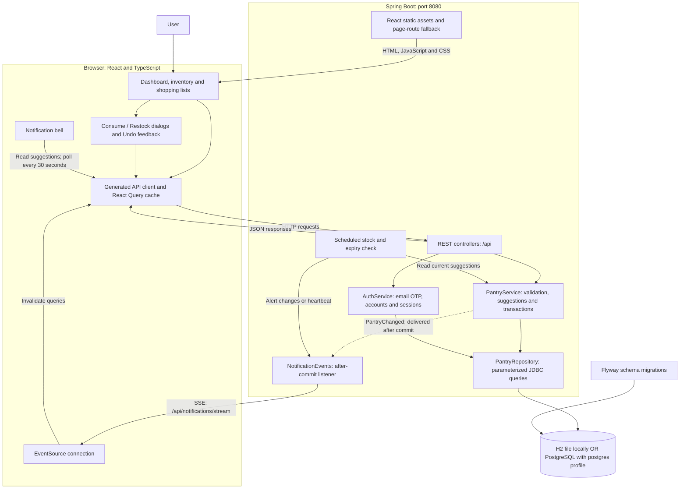
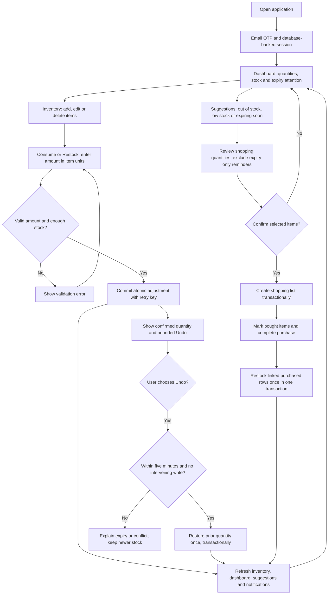

# Architecture

## Application overview

PantryPal is a React application backed by one Spring Boot service and a relational database. Spring Boot serves both the built frontend and the API on port 8080. The diagram below shows the normal full-stack runtime.



The server owns validation, authenticated sessions and committed stock. React Query caches server responses and refetches dependent views after changes. SSE carries refresh signals; the notification bell recovers its alert contents from the suggestions API. There is no message broker or durable notification inbox.

OpenAPI defines the REST contract and generates the TypeScript client; it does not generate the Spring backend. Database changes use new Flyway migrations. Historical Express/Drizzle packages are outside this runtime.

## Pantry and shopping workflow



Normal login/signup uses server-verified email codes and database-backed sessions; the mobile and browser-only mock flows remain previews. Household authorization remains separate work. Shopping-list generation revalidates selected items against current stock on the server. Purchase completion leaves unlinked manual shopping items out of inventory.

## Adjustment transaction and refresh sequence

```mermaid
sequenceDiagram
    actor User
    participant UI as React UI and query cache
    participant API as Spring controller and service
    participant DB as Database
    participant Events as After-commit listener

    User->>UI: Consume or Restock an amount
    UI->>API: POST adjustment with Idempotency-Key
    API->>DB: Begin transaction and lock inventory row
    API->>API: Validate operation, amount and stock
    API->>DB: Look up item-scoped request key
    alt Identical retry
        DB-->>API: Existing adjustment
        API->>DB: Read current inventory; finish without another write
        API-->>UI: Current inventory; no duplicate adjustment
    else Key reused with another payload
        API-->>UI: Reject request without changing stock
    else New valid adjustment
        API->>DB: Update quantity and revision; save history and Undo expiry
        API->>API: Publish transaction-bound PantryChanged event
        API->>DB: Commit stock and history together
        API->>Events: Deliver event after successful commit
        Events-->>UI: SSE inventory_changed refresh signal
        API-->>UI: Confirmed inventory response
        UI->>UI: Refresh dependent queries and show Undo
    end

    Note over UI,Events: Response refresh works without SSE; the bell also polls suggestions
    Note over API,DB: Rollback preserves stock/history and suppresses the transaction event
```

Undo is a separate transaction using the original adjustment key. It locks the inventory row, checks expiry and revision, and commits the restored quantity and used marker together. A successful retry reports `already_undone` without applying another change. The SSE signal and HTTP response are separate refresh paths; clients must not depend on their arrival order.

## Runtime modes and implementation details

The `/login` and `/signup` routes use server-side email OTP in the full-stack runtime. `GET /api/auth/session` returns the current account and CSRF token. `POST /api/auth/code` sends an unpredictable, expiring code via SMTP; `POST /api/auth/verify` consumes it once, creates or finds an account, rotates the session ID, and returns a new CSRF token. Spring Session JDBC stores HttpOnly session cookies in the database so a signed-in session survives a reload or server restart. Spring Security requires the session for pantry, shopping and notification APIs and requires `X-CSRF-TOKEN` on unsafe requests. Server-side logout invalidates the session. Mailpit captures local email; production SMTP requires a configured delivery provider and HTTPS-secure cookies. The mobile option is explicitly an unauthenticated preview. `dev:mock` retains its separate in-browser demo code and localStorage data. Pantry and shopping data is account-scoped; household membership and sharing are separate work. V6 assigns legacy rows to the lowest-ID account if one exists at migration time; otherwise those rows remain unowned. Signup never claims unowned legacy rows; operators must verify ownership before assigning them, as documented in [environment setup](ENVIRONMENT.md#claiming-legacy-shared-pantry-data).

The application overview above shows this runtime. Optional Vite development on port 5173 serves React with hot reload and proxies `/api`, including SSE, to Spring Boot on port 8080. The browser demo adapter is an alternative runtime using localStorage and does not contact Spring or a database.

The frontend production build is included in the Spring classpath and executable JAR by Maven resources. `pnpm start` builds it before launching Spring; the Docker multi-stage build does both. Explicit client routes forward to `index.html`, while API endpoints and missing asset requests retain their normal HTTP behavior. Optional Vite development on :5173 proxies `/api` to Spring for hot reload.

[OpenAPI](../lib/api-spec/openapi.yaml) describes the existing REST contract. Keep generated React hooks compatible. The additive SSE endpoint uses `pantry-event` events with `{ "type": "inventory_changed" | "purchase_completed" | "alerts_changed" | "heartbeat" }`; `ready` confirms connection.

The controller owns HTTP routing, the service owns validation and transactions, and the repository owns parameterized SQL and camelCase serialization. SQL identifiers are an internal allowlist. Flyway owns the new database schema.

Inventory changes and completed purchases publish Spring application events tagged with their owning account. Transactional listeners notify only that account's connected browsers, and the SSE payload contains only the existing event type. A scheduled check compares current stock/expiry suggestions independently per account and routes alert changes and heartbeats to that account's streams. Alert contents remain available through the authenticated suggestions API. Browser EventSource reconnects automatically. The notification bell retains its 30-second snapshot polling as fallback.

Rules use UTC dates: zero quantity is critical; positive quantity at/below threshold is low; expiry today through seven days ahead is expiring soon. Suggestions choose one reason per item, in that priority order. Category attention can count both stock and freshness problems for an item. Expiry-only reminders do not generate purchases.

Purchases lock the list, atomically increase linked inventory, and mark rows as restocked in one transaction. Repeating completion skips already applied rows. Unlinked manual shopping items do not create pantry records automatically. Item changes are scoped to the supplied shopping-list ID.

There is no message broker or deployment platform. Email OTP and session authentication are part of the active backend; household membership and production hardening remain separate work. Historical Express/Drizzle sources are reference material, not runtime dependencies.

Confirmed consume/restock changes show dismissible Undo feedback above the React routes, so it remains available while navigating between views. The client bounds the action to five minutes from the first request (including safe retries); the server remains authoritative about eligibility. Undo uses the original adjustment key and explains expired, already-used, missing and conflicting results. Uncertain Undo responses can be retried with the same key. Adjustment and Undo responses refresh inventory lists/details, dashboard stats, suggestions and the notification snapshot directly, even without SSE. Demo mode implements the same Undo outcomes in browser storage, including revision conflicts from edits and completed purchases.

Consume/restock adjustments require an `Idempotency-Key` and retain their existing inventory-item response. `POST /api/inventory/{id}/undo` accepts `{ "idempotencyKey": "original-key" }` for that item. Undo restores only the recorded prior quantity within five minutes; any intervening edit, adjustment, undo or purchase invalidates it, even if quantity returns to the same value. Every inventory update atomically increments an internal revision, excluded from public inventory responses. V3 adds revision and undo metadata without making historical V2 adjustments eligible. Row locking serializes undo with all inventory writes; stock, revision and undo marker commit together. Successful undo returns `status: undone` and current `inventory`; retries return `already_undone` and current inventory without another write or event, even after expiry. Invalid input returns 400, missing item/key 404, conflict or historical record 409, and expiry 410. Notifications retain the existing after-commit path.
