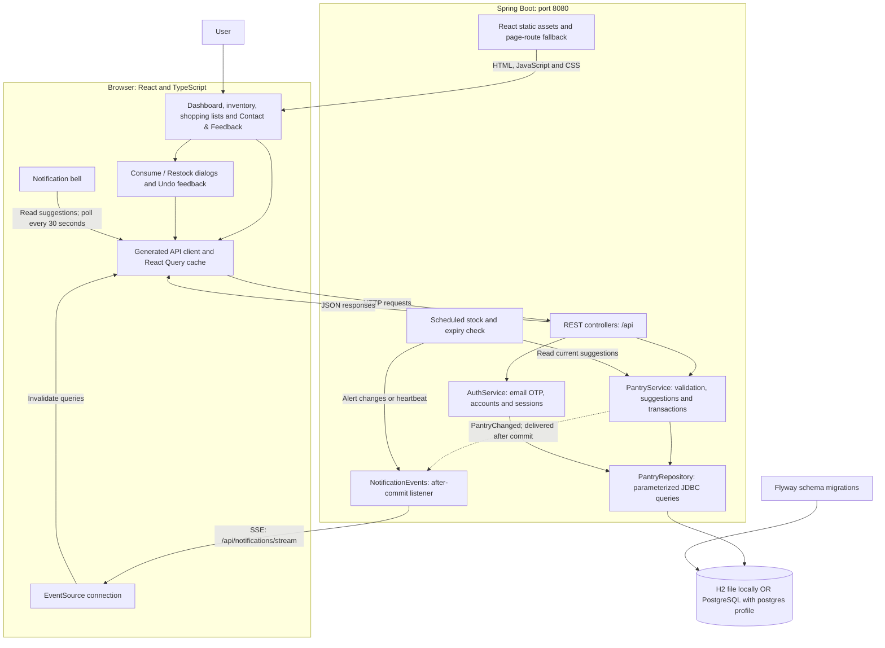
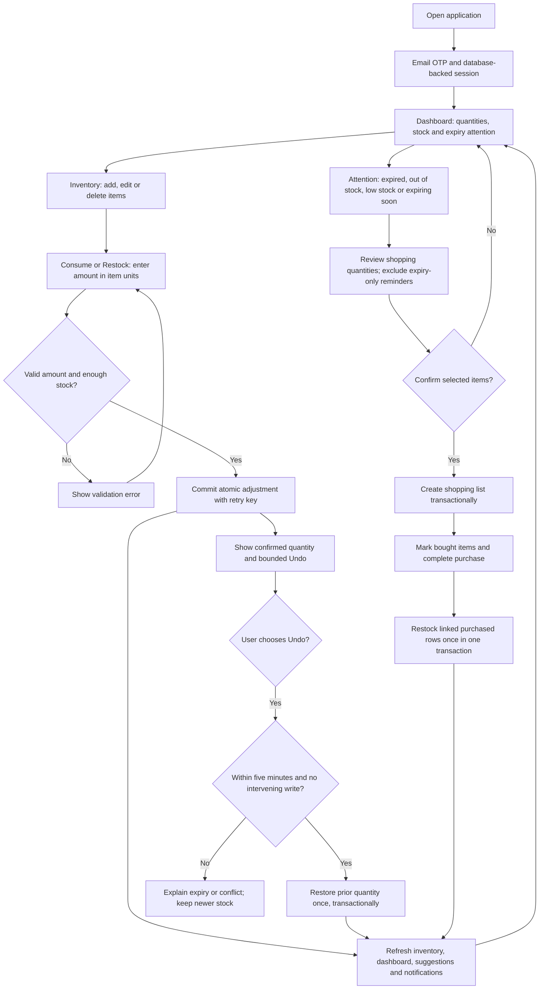

# Architecture

Account deletion is documented in the [data inventory and deletion protocol](GS-137-DATA-DELETION.md). The authenticated account operation requires server-recorded email verification within five minutes, deletes active owned records transactionally, and revokes all sessions. Pantry writes acquire an account lock so a concurrent write cannot survive deletion. After-commit cleanup closes notification streams; API requests also reject stale sessions whose account no longer exists. Mailbox cleanup and backup restore reconciliation remain operator release gates. The privacy page is explicitly a draft pending deployment review.

## Application overview

PantryPal is a React application backed by one Spring Boot service and a relational database. Spring Boot serves both the built frontend and the API on port 8080. The diagram below shows the normal full-stack runtime.



The server owns validation, authenticated sessions and committed stock. React Query caches server responses and refetches dependent views after changes. SSE carries refresh signals; the notification bell recovers its alert contents from the suggestions API. There is no message broker or durable notification inbox. The public Contact & Feedback page and signed-in quick-feedback dialog use a CSRF-protected API; submissions are validated, rate limited and sent to the environment-configured support mailbox without being persisted or logged. The address and any response-time note are environment-configured; absent details are not invented. A success response means the SMTP transport accepted the message.

OpenAPI defines the REST contract and generates the TypeScript client; it does not generate the Spring backend. Database changes use new Flyway migrations. Historical Express/Drizzle packages are outside this runtime.

React routes load on demand through dynamic imports. The session gate runs before the route loading boundary, so an unauthenticated private URL redirects before loading that page's code. A pending route shows an accessible loading status; a failed page load offers a full reload at the same URL. The query client, session gate and adjustment feedback provider stay above this boundary, preserving authentication, cached data and Undo feedback across navigation. See the [frontend bundle verification](GS-104-FRONTEND-BUNDLE.md) for measurements and loading checks.

## Pantry and shopping workflow



Normal login/signup uses server-verified email codes and database-backed sessions; email is the only offered method by default, and browser-only mock authentication remains a preview. Household authorization remains separate work. Shopping-list generation revalidates selected items against current stock on the server. Purchase completion leaves unlinked manual shopping items out of inventory.

## Adjustment transaction and refresh sequence

```mermaid
sequenceDiagram
    actor User
    participant UI as React UI and query cache
    participant API as Spring controller and service
    participant DB as Database
    participant Events as After-commit listener

    User->>UI: Consume or Restock an amount
    UI->>API: POST adjustment with Idempotency-Key
    API->>DB: Begin transaction and lock inventory row
    API->>API: Validate operation, amount and stock
    API->>DB: Look up item-scoped request key
    alt Identical retry
        DB-->>API: Existing adjustment
        API->>DB: Read current inventory; finish without another write
        API-->>UI: Current inventory; no duplicate adjustment
    else Key reused with another payload
        API-->>UI: Reject request without changing stock
    else New valid adjustment
        API->>DB: Update quantity and revision; save history and Undo expiry
        API->>API: Publish transaction-bound PantryChanged event
        API->>DB: Commit stock and history together
        API->>Events: Deliver event after successful commit
        Events-->>UI: SSE inventory_changed refresh signal
        API-->>UI: Confirmed inventory response
        UI->>UI: Refresh dependent queries and show Undo
    end

    Note over UI,Events: Response refresh works without SSE; the bell also polls suggestions
    Note over API,DB: Rollback preserves stock/history and suppresses the transaction event
```

Undo is a separate transaction using the original adjustment key. It locks the inventory row, checks expiry and revision, and commits the restored quantity and used marker together. A successful retry reports `already_undone` without applying another change. The SSE signal and HTTP response are separate refresh paths; clients must not depend on their arrival order.

## Runtime modes and implementation details

The `/login` and `/signup` routes use server-side email OTP in the full-stack runtime. `GET /api/auth/session` returns the current account and CSRF token. `POST /api/auth/code` sends an unpredictable, expiring code via SMTP; `POST /api/auth/verify` consumes it once, creates or finds an account, rotates the session ID, and returns a new CSRF token. Spring Session JDBC stores HttpOnly session cookies in the database so a signed-in session survives a reload or server restart. Spring Security requires the session for pantry, shopping and notification APIs and requires `X-CSRF-TOKEN` on unsafe requests. Server-side logout invalidates the session. Mailpit captures local email; production SMTP requires a configured delivery provider and HTTPS-secure cookies. The mobile option is hidden by default; `VITE_ENABLE_MOBILE_PREVIEW=true` explicitly restores the preserved unauthenticated preview. It never issues a backend session or sends SMS. `dev:mock` retains its separate in-browser demo code and localStorage data. Pantry and shopping data is account-scoped; household membership and sharing are separate work. V6 assigns legacy rows to the lowest-ID account if one exists at migration time; otherwise those rows remain unowned. Signup never claims unowned legacy rows; operators must verify ownership before assigning them, as documented in [environment setup](ENVIRONMENT.md#claiming-legacy-shared-pantry-data).

Auth rate limits commit before challenge transactions begin, avoiding nested connection acquisition. SMTP runs after an unusable challenge reservation commits; successful delivery activates only the matching challenge. Failure cleanup cannot invalidate a newer resend. Login reserves and enqueues the same response for every valid email; a dedicated worker checks account existence and sends only for existing accounts. SMTP latency and failures are kept off the login request thread. The worker has four threads and a bounded queue of 128 tasks with rejection rather than caller-thread delivery. Queue rejection returns the same generic 503 regardless of account existence. Queued login work is process-local and best effort; a restart can lose pending delivery, and the user must request another code after the cooldown. Stale/expired queued work is skipped. Signup retains synchronous SMTP and its existing delivery failure response. Login verification failures, including expiry and exhausted challenge attempts, use the same generic 400; global IP/email verification quotas still return 429. Verification keeps code consumption and account creation atomic, committing expected rejection counters before returning the error. See [auth concurrency verification](GS-110-AUTH-CONCURRENCY.md) for historical H2 and PostgreSQL results, and [email OTP flow](EMAIL-OTP-AUTH-FLOW.md) for current request behavior.

The application overview above shows this runtime. Optional Vite development on port 5173 serves React with hot reload and proxies `/api`, including SSE, to Spring Boot on port 8080. The browser demo adapter is an alternative runtime using localStorage and does not contact Spring or a database.

Notification streams recheck their Spring Session record before sending the ready message or any event. Expired or deleted sessions close their streams; the scheduled notification check also removes idle expired streams at the configured expiry-check interval. These lookups do not refresh the session's last-access time. Logout and session rotation mark the affected stream closed without waiting for session lookup or delivery. Session lookup and emitter operations run outside the subscriber state monitor. A send already admitted may finish; its sender then completes the emitter. Waiting senders recheck closure before looking up the session or starting delivery.

Session-store lookup failures are isolated per subscriber. An initial lookup failure closes and removes the new subscription without sending `ready`. Established streams skip delivery when validation fails and can retry validation on a later event; one failed lookup does not interrupt other subscribers or the scheduled expiry sweep. A successful expiry check never substitutes for the validation immediately before delivery.

The frontend production build is included in the Spring classpath and executable JAR by Maven resources. `pnpm start` builds it before launching Spring; the Docker multi-stage build does both. Explicit client routes forward to `index.html`, while API endpoints and missing asset requests retain their normal HTTP behavior. Optional Vite development on :5173 proxies `/api` to Spring for hot reload.

[OpenAPI](../lib/api-spec/openapi.yaml) describes the existing REST contract. Keep generated React hooks compatible. The additive SSE endpoint uses `pantry-event` events with `{ "type": "inventory_changed" | "purchase_completed" | "alerts_changed" | "heartbeat" }`; `ready` confirms connection.

Shopping-list names are normalized only on creation and rename; reads preserve legacy values unchanged. Java, React, and demo mode remove the same boundary code points: U+0009–U+000D, U+0020, U+00A0, U+1680, U+2000–U+200A, U+2028, U+2029, U+202F, U+205F, U+3000, and U+FEFF. Internal whitespace is preserved. A normalized name must be non-empty and at most 100 Unicode code points; supplementary characters such as emoji count as one code point.

The controller owns HTTP routing, the service owns validation and transactions, and the repository owns parameterized SQL and camelCase serialization. SQL identifiers are an internal allowlist. Flyway owns the new database schema.

Inventory changes and completed purchases publish Spring application events tagged with their owning account. Transactional listeners enqueue refresh signals after commit onto a dedicated worker, which notifies only that account's connected browsers. Enqueuing returns without session lookups or emitter writes: Spring's after-commit callback still holds the transaction connection until cleanup, so synchronous delivery can exhaust the shared JDBC pool while requesting another connection to validate a session. The worker has one thread and a bounded queue of 128 tasks. Overflow or shutdown rejects and logs the signal without running it on the transaction thread. Delivery remains best effort; a slow subscriber can delay queued signals, and clients recover current state through HTTP responses and snapshot polling. Each delivery still validates the session immediately before sending.

The SSE payload contains only the existing event type. A scheduled check compares current stock/expiry suggestions independently per account and routes alert changes and heartbeats to that account's streams. Alert contents remain available through the authenticated suggestions API. Browser EventSource reconnects automatically. The notification bell retains its 30-second snapshot polling as fallback.

Rules use UTC dates: zero quantity is critical; positive quantity at/below threshold is low; expiry today through seven days ahead is expiring soon. Positive-quantity items dated before today also receive a distinct `expired` alert, including items that already have a low-stock alert. The existing stock-before-upcoming-expiry priority remains unchanged. Expired alerts sort first. Category attention counts stock and freshness conditions independently while counting each affected inventory item once in its total. Shopping generation explicitly accepts only `critical` and `low`, so expiry-only alerts never create purchases.

Dashboard stats include `expiredCount`; Inventory supports `stock=expired` and links using `item=<inventory ID>` to review the exact account-scoped item. Expired cards show the expiry date and an Expired badge even when also low on stock. Correcting/removing the expiry date, deleting the item, or reducing its quantity to zero clears expired attention. Reading an alert marks it read but does not dismiss the underlying condition; there is no persistent handled state. Notification read markers use account-scoped storage and inventory IDs rather than item names.

The scheduler detects date-based changes in the account's suggestion snapshot and publishes the existing `alerts_changed` signal. Open frontend pages also check the UTC date every 30 seconds and when visibility changes, refreshing stats/suggestions after rollover and recomputing Inventory/category attention. Expired and upcoming-expiry labels use the same UTC date convention throughout the UI and demo mode. The OpenAPI client is regenerated for the additional urgency and count; no database migration is needed.

Purchases lock the list, atomically increase linked inventory, and mark rows as restocked in one transaction. Repeating completion skips already applied rows. Unlinked manual shopping items do not create pantry records automatically. Item changes are scoped to the supplied shopping-list ID.

There is no message broker or deployment platform. Email OTP and session authentication are part of the active backend; household membership and production hardening remain separate work. Historical Express/Drizzle sources are reference material, not runtime dependencies.

Confirmed consume/restock changes show dismissible Undo feedback above the React routes, so it remains available while navigating between views. The client bounds the action to five minutes from the first request (including safe retries); the server remains authoritative about eligibility. Undo uses the original adjustment key and explains expired, already-used, missing and conflicting results. Uncertain Undo responses can be retried with the same key. Adjustment and Undo responses refresh inventory lists/details, dashboard stats, suggestions and the notification snapshot directly, even without SSE. Demo mode implements the same Undo outcomes in browser storage, including revision conflicts from edits and completed purchases.

Consume/restock adjustments require an `Idempotency-Key` and retain their existing inventory-item response. `POST /api/inventory/{id}/undo` accepts `{ "idempotencyKey": "original-key" }` for that item. Undo restores only the recorded prior quantity within five minutes; any intervening edit, adjustment, undo or purchase invalidates it, even if quantity returns to the same value. Every inventory update atomically increments an internal revision, excluded from public inventory responses. V3 adds revision and undo metadata without making historical V2 adjustments eligible. Row locking serializes undo with all inventory writes; stock, revision and undo marker commit together. Successful undo returns `status: undone` and current `inventory`; retries return `already_undone` and current inventory without another write or event, even after expiry. Invalid input returns 400, missing item/key 404, conflict or historical record 409, and expiry 410. Notifications retain the existing after-commit path.
