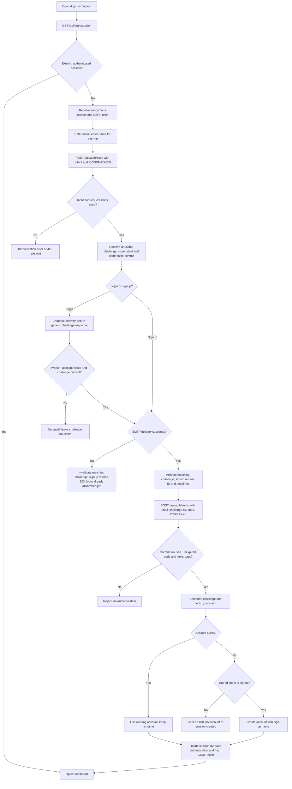

# Email OTP authentication flow (GS-14)

This document describes the full-stack email sign-in and sign-up flow implemented by [AuthService](../backend/src/main/java/com/pantrypal/AuthService.java), [AuthController](../backend/src/main/java/com/pantrypal/AuthController.java), and [SecurityConfig](../backend/src/main/java/com/pantrypal/SecurityConfig.java). Email is the only visible method by default in both normal and demo mode. The browser-only `dev:mock` flow and the opt-in mobile preview do not authenticate with Spring. The mobile preview is retained behind `VITE_ENABLE_MOBILE_PREVIEW`, disabled by default; enabling it does not provide SMS authentication.

## End-to-end flow



Every valid login request reserves an unusable challenge and enqueues delivery, returning the same success shape for registered and unregistered emails: `challengeId`, `expiresAt`, and `resendAt`. The worker checks `accounts` and sends only for an existing account; an unregistered login never sends email. SMTP latency and failure do not affect the login response. The UI says “If an account exists for this email, we'll send a verification code” and offers a Create an account link. The stored intent, not a value supplied during verification, decides whether an absent account may be created. Signup retains its synchronous delivery and existing account creation behavior.

The bounded worker has four threads and a queue of 128 tasks. It never runs delivery on the request thread; overflow or shutdown returns a generic 503 for any login, independently of account existence. This process-local queue is not durable: restart can lose pending delivery. Users can request another code after the cooldown. Account lookup and SMTP execute outside the request path rather than attempting to guarantee constant network response times.

## Request and session sequence

```mermaid
sequenceDiagram
    actor User
    participant UI as React auth screen
    participant API as Spring auth endpoints
    participant DB as Database
    participant Mail as SMTP / Mailpit

    UI->>API: GET /api/auth/session
    API-->>UI: account or anonymous session + CSRF token
    User->>UI: Choose Sign in or Create account
    UI->>API: POST /api/auth/code (email, intent, name for signup, CSRF)
    API->>DB: Claim IP/email request limits
    API->>DB: Lock and replace email challenge as unusable; commit
    alt Login
        API-->>UI: challengeId, expiresAt, resendAt (same response for all accounts)
        Note over API,Mail: Background worker checks current challenge and account existence
        opt Existing account and current, unexpired challenge
            API->>Mail: Send six-digit login code
            API->>DB: Activate matching challenge on success; invalidate on failure
        end
        Note over API,DB: Unknown accounts get no email and cannot authenticate
    else Signup
        API->>Mail: Send six-digit signup code
        alt Delivery failed
            API->>DB: Clear hash only if this challenge is still current
            API-->>UI: 503; request another code later
        else Delivery succeeded
            API->>DB: Activate only if this challenge is still current; commit
            API-->>UI: challengeId, expiresAt, resendAt
        end
    end
        User->>UI: Enter emailed code
        UI->>API: POST /api/auth/verify (email, challengeId, code, CSRF)
        API->>DB: Claim IP/email verification limits
        API->>DB: Lock challenge; check ID, use, expiry, attempts, HMAC
        alt Valid signup code; account absent
            API->>DB: Consume code and create named account
        else Valid login code; account absent
            API->>DB: Consume code; leave accounts unchanged
            API-->>UI: Generic 400; remain signed out
        else Valid code; account exists
            API->>DB: Consume code; reuse account and existing name
        end
        opt Account available
            API->>DB: Rotate and persist authenticated session
            API-->>UI: Account, new CSRF token, HttpOnly session cookie
            UI->>UI: Open dashboard
        end
```

The six-digit code itself is emailed but not stored in the database. The database stores an HMAC-SHA-256 digest bound to the challenge ID. Code comparison is constant-time. The default code lifetime is five minutes; one successful verification consumes the code. The backend never issues the browser demo code `123456`.

The browser sends the CSRF token from `GET /api/auth/session` on auth writes and refreshes it after verification or logout. Authentication is stored by Spring Session JDBC, not browser storage. The `PANTRYPAL_SESSION` cookie is HttpOnly and SameSite=Lax; the Secure flag is enabled outside the local profile by default. The configured session lifetime and cookie age are seven days. Protected `/api` routes require a session; unsafe requests also require a CSRF token.

## Edge cases and observable outcomes

| Case | API outcome | Persisted state / next step |
| --- | --- | --- |
| Invalid email or intent; missing, blank, or over-100-character sign-up name | `400` from code request | No challenge issued. Correct the input. |
| Unregistered email chooses **Sign in** | Code request succeeds with the usual challenge response | Worker skips email and invalidates the matching reservation. No account is created. |
| Attempt to verify an unregistered login | Generic `400` at verification | No account or authenticated session is created. Use **Create account** and request a new signup code. |
| Correct sign-up code for an unregistered email | Authenticated `200` | One account is created with the trimmed sign-up name. |
| Correct sign-up code for an existing account | Authenticated `200` | Existing account is reused; its name is not overwritten. |
| Wrong code | Generic `400` | Attempt count increases and persists. The challenge remains usable until the attempt cap or expiry. |
| Fifth failed attempt, then another verification | Signup returns `429`; login returns generic `400` | Request another code; the attempt count resets with the new challenge. Global verification quotas still return `429` for both intents. |
| Expired code | Signup returns `410`; login returns generic `400` | No authentication. Request another code. Login failures do not disclose whether any code was delivered. |
| Reused, replaced, or unknown challenge ID | Generic `400` | Only the newest challenge for that email can be verified. |
| Resend during the cooldown | `429` | Previous challenge remains current; wait until `resendAt`. |
| Resend after the cooldown | New challenge response | New ID, code, intent, and expiry replace the old challenge; old code cannot verify. |
| Request or verification rate limit exceeded | `429` | Limits are tracked by IP and normalized email in separate committed transactions, even for rejected requests. |
| SMTP delivery fails | Signup returns `503`; login keeps its original generic `200` acknowledgment | Matching challenge hash is cleared and the challenge marked used; a newer resend is preserved. Retry after request limits allow it. Login delivery logs contain no recipient, code, or SMTP exception details. |
| Login queue full or shut down | Generic `503` | Matching reservation invalidated; no request-thread SMTP fallback. Same response for existing and absent accounts. |
| Missing or invalid CSRF token on an auth write | `403` | Obtain a fresh token with `GET /api/auth/session`; no requested auth change runs. |
| Protected API call without a session | `401` | Sign in before accessing pantry, shopping, or notifications. |
| Verification response is lost after success | Browser retries `GET /api/auth/session` | If the session was persisted, the UI restores it and opens the dashboard; it does not reapply account creation. |
| Logout | `200` with anonymous session and fresh CSRF token | Authenticated session is invalidated. |
| Server restarts with no configured `AUTH_OTP_SECRET` | Old pending codes fail verification | A new process-local HMAC secret is generated; existing signed-in database sessions remain available. |

Default server limits are 20 code requests per IP per hour, 5 per email per hour with a 30-second resend cooldown, 60 verification requests per IP per hour, 20 per email per hour, and 5 attempts per challenge. See [environment setup](./ENVIRONMENT.md) for configurable OTP values and SMTP settings.

## Data and implementation boundaries

- [V4](../backend/src/main/resources/db/migration/V4__email_authentication.sql) creates accounts, challenges, rate-limit buckets, and Spring Session tables. [V5](../backend/src/main/resources/db/migration/V5__email_challenge_intent.sql) records challenge intent and classifies pending challenges with a stored name as sign-up challenges.
- Auth orchestration does not hold a transaction while claiming rate limits. Each limit commits independently before the short challenge transaction starts, so rejected requests still count without requiring a second connection while holding the first.
- Request and verification use a row lock on the email challenge. Code consumption and account creation occur in one transaction. Expected verification errors commit failed-attempt counts and consumed unknown-account login challenges; unexpected database errors roll back.
- SMTP runs outside database transactions. A reserved challenge is unusable until delivery succeeds. Activation and failure cleanup match the challenge ID, so completion of an older delivery cannot change a newer resend or revive a consumed code. A process failure during delivery leaves the reservation unusable; the user can request a new code after the cooldown.
- Login and sign-up share the same code-request response shape. Signup acknowledges synchronous delivery; login acknowledges queued processing without confirming delivery or membership. The worker skips stale or expired tasks before SMTP; activation and failure cleanup remain challenge-scoped. The decision to create an account occurs only after code verification, using the stored challenge intent.
- Email authentication creates and verifies accounts; pantry and shopping access is scoped to the signed-in account. Household sharing is separate. Signup does not claim unowned legacy rows; operators must verify ownership before assigning them. See the [legacy data claim procedure](./ENVIRONMENT.md#claiming-legacy-shared-pantry-data).

For the API request and response schema, see [OpenAPI](../lib/api-spec/openapi.yaml). For the wider application flow, see [architecture](./ARCHITECTURE.md).
