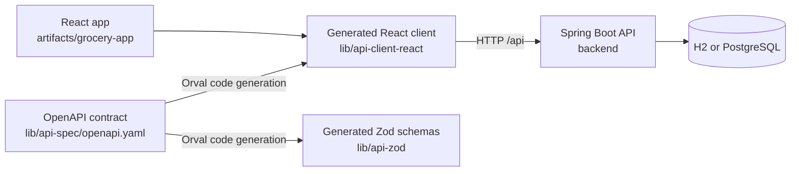
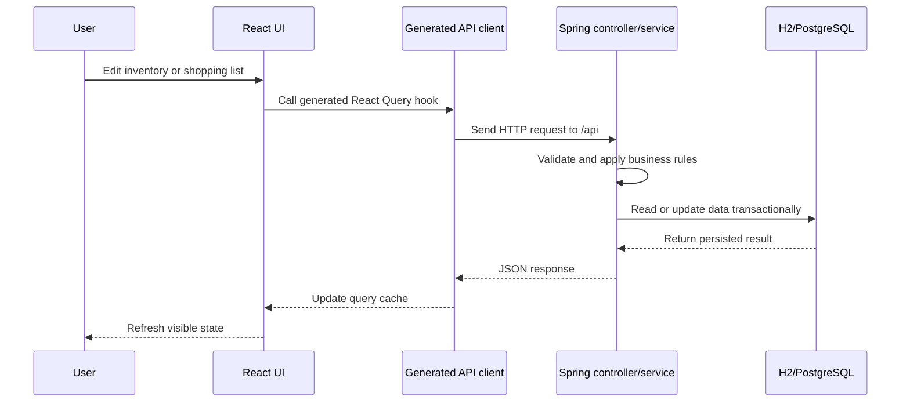
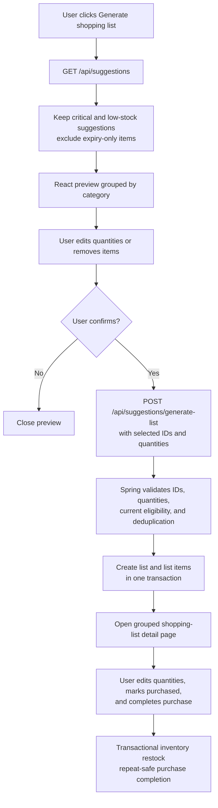
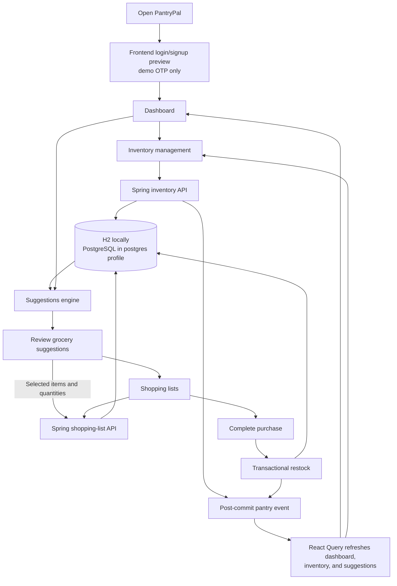
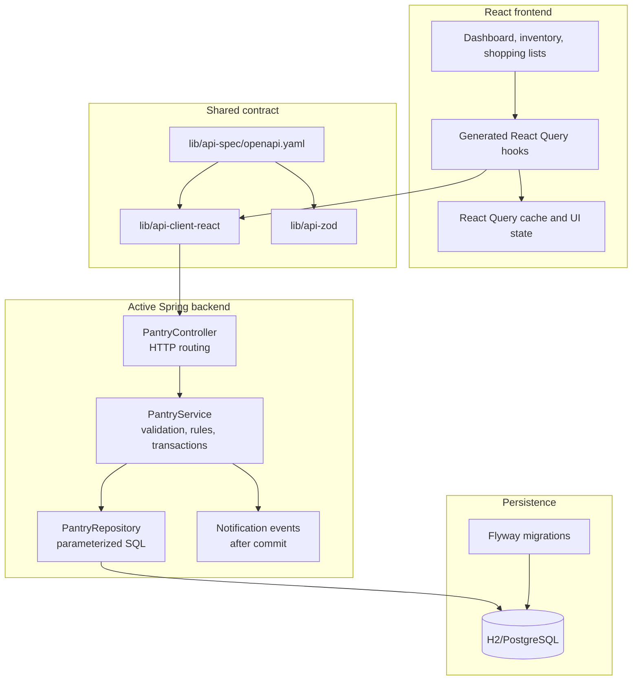

# `lib` folder guide

## What the folder is for

The `lib` folder contains shared libraries and API-contract tooling used by PantryPal. It is not the main application runtime.

The active runtime flow is:

```text
React app
  -> generated React API client
  -> Spring Boot controllers and services
  -> H2 or PostgreSQL through the active backend
```

The active backend is in [`backend/`](../backend/). The `lib` folder mainly provides the API contract, generated clients, generated schemas, and a historical Drizzle database package.

## Architecture overview



The OpenAPI file is the contract shared by the frontend and backend. Generated clients should be regenerated from it instead of edited independently.

## Request and data flow



## GS-18 reviewed shopping-list workflow



The key design boundary is that the browser owns the review experience, while the backend remains authoritative for validation, eligibility, list creation, ownership checks, and transactional persistence.

## End-to-end PantryPal workflow



## Layer responsibilities



The historical [`lib/db`](../lib/db) package is intentionally outside this active backend path. New database behavior belongs in Spring services, repositories, and Flyway migrations.

## `lib/api-spec`

This package is the source of truth for the REST API contract.

### `openapi.yaml`

Defines the `/api` endpoints, request bodies, response shapes, validation rules, and shared schemas. It covers inventory, suggestions, shopping lists, purchases, notifications, and the reviewed shopping-list generation request from GS-18.

When the REST contract changes, update this file first and regenerate the dependent clients.

### `orval.config.ts`

Configures Orval, the code generator. It tells Orval to generate:

- React Query hooks in `api-client-react`
- Zod schemas in `api-zod`
- Requests through the shared `custom-fetch.ts` mutator
- Output into each package's `src/generated` directory

### `package.json`

Defines the private `@workspace/api-spec` package and its code-generation command:

```text
orval --config ./orval.config.ts
```

## `lib/api-client-react`

This is the frontend's generated API client.

### `src/index.ts`

The public package entry point. It re-exports generated API functions, generated TypeScript types, and the fetch configuration helpers.

### `src/custom-fetch.ts`

The shared HTTP wrapper used by generated API functions. It handles:

- Relative API URLs and optional base URLs
- JSON, text, and blob responses
- API error conversion into `ApiError`
- Empty-response handling
- Optional bearer-token injection for future clients

### `src/generated/api.ts`

Generated API functions and React Query hooks, such as:

- `useListInventoryItems`
- `useGetGrocerySuggestions`
- `useGenerateShoppingListFromSuggestions`
- `useGetShoppingList`
- `useUpdateShoppingListItem`
- `usePurchaseShoppingList`

Do not edit this file manually. Change `api-spec/openapi.yaml` and regenerate it.

### `src/generated/api.schemas.ts`

Generated TypeScript interfaces for API requests and responses, including:

- `InventoryItem`
- `InventoryItemInput`
- `InventoryItemUpdate`
- `GrocerySuggestion`
- `ShoppingList`
- `ShoppingListItem`
- `ShoppingListGenerationInput`
- `PurchaseResult`

### `package.json`

Defines the private `@workspace/api-client-react` package and exports `src/index.ts`. React Query is a dependency and React is a peer dependency.

### `tsconfig.json`

TypeScript project configuration for this package. It enables declaration output and composite project builds.

### `dist/*`

Generated TypeScript declaration output. These files are build artifacts derived from `src`; source changes should be made under `src` instead.

### `tsconfig.tsbuildinfo`

TypeScript's incremental-build cache. It speeds up repeated builds and is not application source code.

## `lib/api-zod`

This package contains generated Zod schemas corresponding to the OpenAPI contract.

### `src/index.ts`

Re-exports the generated API definitions and generated schema types.

### `src/generated/api.ts`

Generated Zod API/schema definitions based on `openapi.yaml`.

### `src/generated/types/index.ts`

Barrel file exporting all generated schema types.

### `src/generated/types/categoryCount.ts`

Schema for a category name and item count.

### `src/generated/types/errorResponse.ts`

Schema for the standard API error response.

### `src/generated/types/grocerySuggestion.ts`

Schema for a low-stock or expiry suggestion, including item identity, quantity, category, unit, reason, and urgency.

### `src/generated/types/grocerySuggestionUrgency.ts`

Schema for the urgency values `critical`, `low`, and `expiring_soon`.

### `src/generated/types/healthStatus.ts`

Schema for the health-check response.

### `src/generated/types/inventoryItem.ts`

Schema for a stored inventory item.

### `src/generated/types/inventoryItemInput.ts`

Schema for creating an inventory item.

### `src/generated/types/inventoryItemUpdate.ts`

Schema for partially updating an inventory item.

### `src/generated/types/inventoryStats.ts`

Schema for dashboard counts such as total, low-stock, out-of-stock, and expiring items.

### `src/generated/types/listInventoryItemsParams.ts`

Schema for inventory filters such as category and low-stock status.

### `src/generated/types/purchaseResult.ts`

Schema for purchase completion results, including the number of updated inventory items.

### `src/generated/types/shoppingList.ts`

Schema for shopping-list metadata.

### `src/generated/types/shoppingListWithItems.ts`

Schema for a shopping list together with its item rows.

### `src/generated/types/shoppingListInput.ts`

Schema for creating a shopping list.

### `src/generated/types/shoppingListItem.ts`

Schema for a stored shopping-list item.

### `src/generated/types/shoppingListGenerationInput.ts`

Schema for the reviewed shopping-list generation request introduced for GS-18.

### `src/generated/types/shoppingListGenerationInputItemsItem.ts`

Schema for one selected inventory item and its final requested quantity during reviewed generation.

### `src/generated/types/shoppingListItemInput.ts`

Schema for adding an item to a shopping list.

### `src/generated/types/shoppingListItemUpdate.ts`

Schema for updating a shopping-list item, such as changing its quantity or purchased state.

### `package.json`

Defines the private `@workspace/api-zod` package and its Zod dependency.

### `tsconfig.json` and `tsconfig.tsbuildinfo`

The TypeScript project configuration and incremental-build cache for the package.

All files under `api-zod/src/generated` are generated. Do not edit them directly.

## `lib/db`

This is the historical Drizzle/PostgreSQL database package.

It is not the active database implementation for the current PantryPal backend. The active backend uses Spring Boot, JDBC, Flyway, H2 locally, and PostgreSQL when the PostgreSQL profile is enabled.

### `src/index.ts`

Creates a PostgreSQL connection pool from `DATABASE_URL`, creates the Drizzle database instance, and re-exports the schema.

### `src/schema/index.ts`

Re-exports the table definitions from the inventory and shopping schema files.

### `src/schema/inventory.ts`

Defines the historical Drizzle `inventory_items` table and its inferred insert/select types. It includes product name, category, quantity, unit, threshold, expiry date, notes, and timestamps.

### `src/schema/shopping.ts`

Defines the historical `shopping_lists` and `shopping_list_items` tables. Shopping items can optionally reference inventory items and track quantity, unit, notes, and purchase state.

### `drizzle.config.ts`

Configures Drizzle Kit for PostgreSQL schema operations and requires `DATABASE_URL`.

### `package.json`

Defines the private `@workspace/db` package and historical Drizzle commands such as `push` and `push-force`.

### `tsconfig.json`

TypeScript configuration for the Drizzle package.

## Generated and local-only content

The following content may appear locally but is not source that should be edited:

- `node_modules/`: installed dependencies and command shims
- `node_modules/.cache/`: temporary tool caches
- `dist/`: generated declaration output
- `tsconfig.tsbuildinfo`: incremental TypeScript build metadata

## Working rules

1. Change the API contract in [`api-spec/openapi.yaml`](../lib/api-spec/openapi.yaml) first.
2. Regenerate the React and Zod clients with the configured Orval command.
3. Use generated React hooks from the frontend.
4. Do not hand-edit generated API or Zod files.
5. Do not implement new active backend behavior in `lib/db`.
6. Database changes for the active Spring backend belong in new Flyway migrations under [`backend/src/main/resources/db/migration/`](../backend/src/main/resources/db/migration/).
